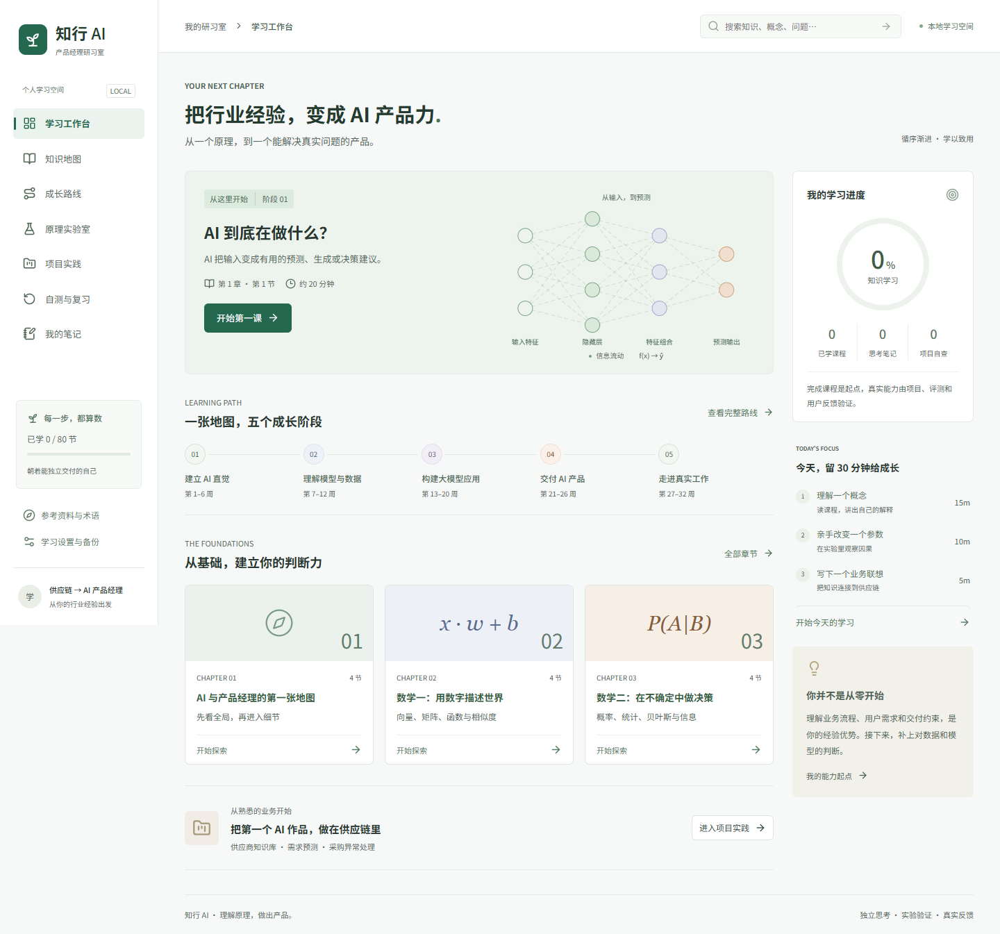

# 知行 AI · 产品经理研习室

面向传统行业、尤其是供应链产品经理的中文 AI 学习助手。从数学直觉出发，逐步学习模型、数据、大模型应用、产品规划、项目交付与实际工作。

**[在线学习](https://luojinghao.github.io/ai-product-manager-learning-assistant/) · [中文操作手册](docs/user-guide.md) · [安装与部署](docs/deployment.md) · [项目实践指南](docs/project-playbook.md)**

已通过 GitHub Pages 发布，可直接把在线学习链接分享给其他电脑和手机。更新时请等待 GitHub Actions 部署成功。

## 学习内容

| 阶段 | 主题 | 产出目标 |
| --- | --- | --- |
| 建立 AI 直觉 | AI 任务、向量矩阵、概率统计、导数梯度 | 讲清原理，手算基础例子 |
| 理解模型与数据 | 数据、机器学习、评估、深度学习、多模态 | 判断方案、指标与数据质量 |
| 构建大模型应用 | LLM、提示、RAG、Agent | 画出应用流程并建立评测 |
| 交付 AI 产品 | 工程选型、用户研究、PRD、评测治理 | 形成可检查的产品方案 |
| 走进真实工作 | 上线运营、商业、工作日常、作品集 | 完成实践并获得真实反馈 |

- 20 章、80 节课程，每节有白话解释、过程图、关键表达、供应链案例、任务与自测。
- 20 组章节对照表和完整算例；7 个参数可调的原理实验及动态图示。
- 32 周可调路线，含学习进度、笔记、错题复习和 JSON 备份。
- 3 个可运行教学基线：供应商知识库、需求预测与补货建议、采购异常处理 Copilot。

## 本地快速启动

需要 Node.js 22 LTS 或更新的兼容 LTS，推荐新版 Chrome / Edge。手机直接访问在线版，不用安装 Node。

    git clone https://github.com/luojinghao/ai-product-manager-learning-assistant.git
    cd ai-product-manager-learning-assistant
    npm ci
    npm run dev

打开终端显示的地址，默认 http://127.0.0.1:5173/ 。第一次下载必须先 npm ci 安装依赖。

Windows 安装好依赖后可双击 [start-learning.cmd](start-learning.cmd)，检测服务、启动并尝试打开浏览器；自动打开受限时，手动访问显示的地址。启动日志为 .learning-server.log 与 .learning-server-error.log。

没有 Git 时，点仓库 **Code → Download ZIP**，解压后在含 package.json 的文件夹打开终端，运行 npm ci 和 npm run dev。不要直接双击 index.html。

## 建议的第一天

1. 工作台进入“AI 到底在做什么？”，阅读解释和流程图。
2. 用熟悉的供应链流程对应输入、输出与业务动作。
3. 切到“自测一下”，提交答案并阅读解析。
4. 在“实践与笔记”写自己的解释，再标记已学。
5. 原理实验室运行梯度下降，观察一步更新前后的损失。
6. 在“学习设置与备份”导出学习记录。

详细页面操作、实验步骤、项目使用和备份恢复见[中文操作手册](docs/user-guide.md)。

## 项目与验证

    npm run project:knowledge
    npm run project:forecast
    npm run project:agent
    npm test
    npm run test:e2e
    npm run build
    npm run preview

本地浏览器测试默认使用 Google Chrome；无 Chrome 时见部署指南的 Chromium 说明。GitHub Actions 自动执行内容测试、浏览器测试、构建与 main 分支 Pages 发布。首次在 Settings → Pages 选择 GitHub Actions，见[安装与部署](docs/deployment.md)。

[交付验证记录](docs/verification.md)说明已验证范围；历史截图和证据位于 docs/。

## 数据和能力边界

笔记、答案、进度和项目工作稿保存在当前浏览器 localStorage，无账号、云同步或模型调用。不同人各自保存；换电脑、浏览器、地址或清理数据前，导出 JSON 迁移。本地网址与在线网址不自动互通。发布源码不会上传浏览器中的个人笔记。

备份导入合并已学课程，同一条笔记、答案和项目使用导入版本。损坏记录保留原始内容并暂停覆盖，提供导出恢复入口。

课程搜索是原文匹配，未接入生成式答疑。知识库使用关键词检索，预测使用合成数据，采购工具为模拟；没有真实 ERP 或邮件发送。教学指标不等于生产收益。

覆盖 AI 产品经理核心体系，不穷尽所有 AI 研究方向。32 周是建议节奏，不能认证“五年经验”；成熟能力需要真实用户、外部评审、交付和持续运营。

## 项目结构

    src/                     课程、图解、实验和学习界面
    examples/                三个可运行教学项目
    docs/user-guide.md       学习者操作手册
    docs/deployment.md       安装、分享与部署
    docs/project-playbook.md 实践项目扩充与验收
    tests/                   内容、边界和浏览器验证
    .github/workflows/       自动验证和 Pages 发布

技术栈：React 19、Vite 6、Lucide、mathjs、ml-regression-simple-linear、Playwright。无后端和运行时模型服务依赖。第三方库及外部资料遵循各自许可与使用条件，外部课程未打包转载。
