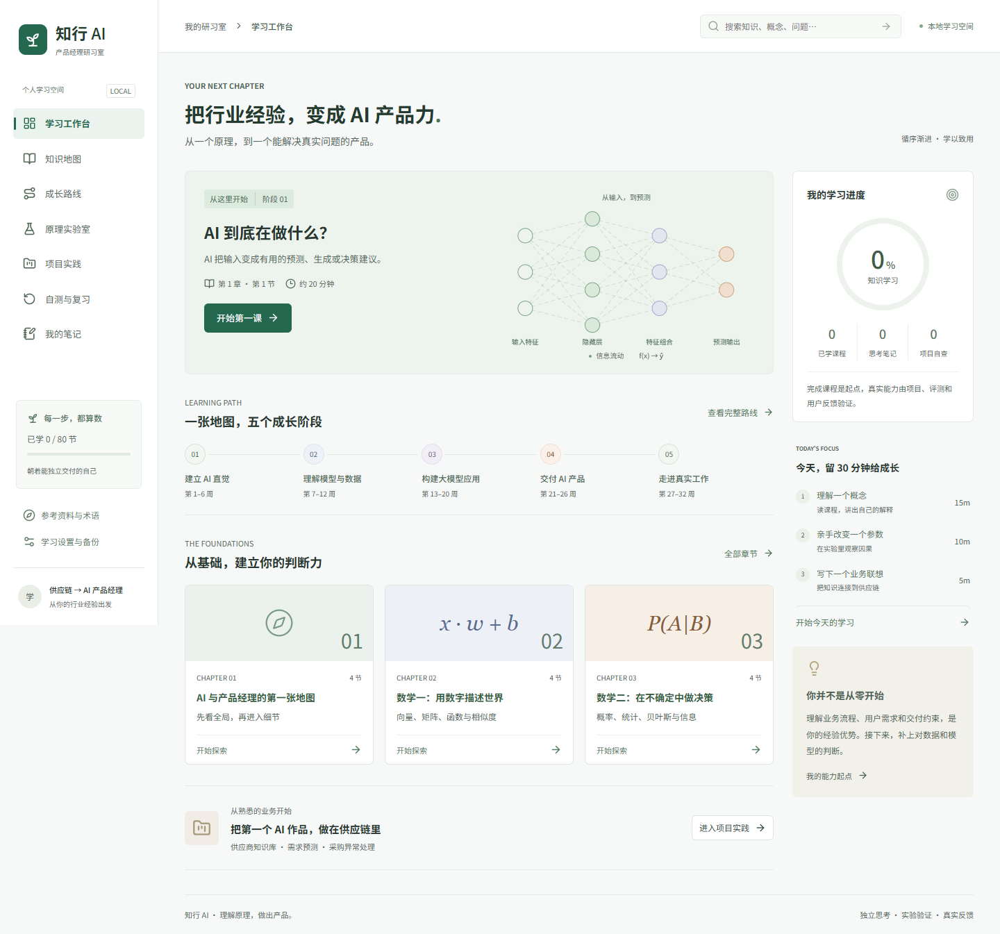
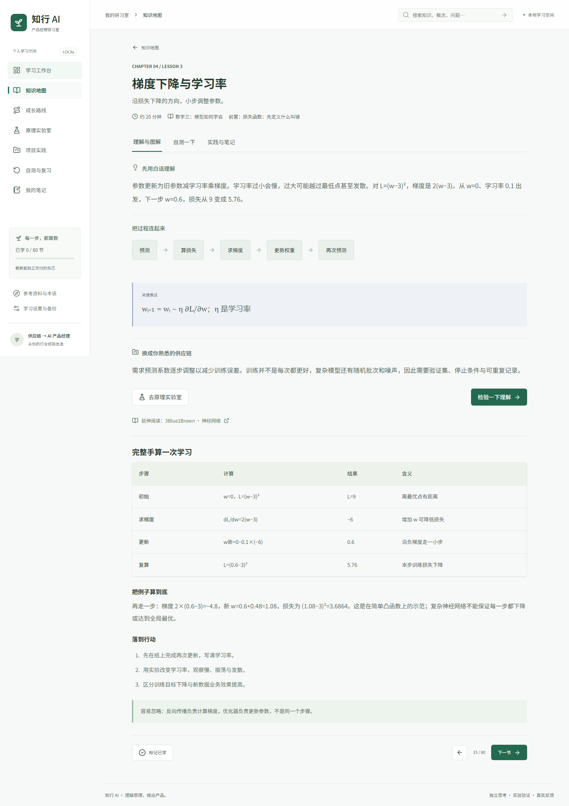

# 知行 AI 操作手册

适用版本：1.0。面向没有 AI 基础、已有产品或供应链经验的学习者。

## 1. 打开与开始

在线入口：https://luojinghao.github.io/ai-product-manager-learning-assistant/

打开即可学习，不需注册或模型密钥。在线版更新需仓库发布成功。本地运行见[安装与部署](deployment.md)。电脑左侧是导航，手机点左上角菜单打开；点关闭按钮、背景或按 Escape 可关闭。

## 2. 每个页面做什么

| 页面 | 用途 | 推荐操作 |
| --- | --- | --- |
| 学习工作台 | 继续学习、阶段与进度 | 开始第一课或继续学习 |
| 知识地图 | 浏览 20 章 80 节 | 筛选阶段，展开章节，进入课程 |
| 成长路线 | 阶段目标和验收 | 选择每周时间，安排学习 |
| 原理实验室 | 改参数、观察输出 | 一次改一个参数，记录变化 |
| 项目实践 | 三个供应链项目 | 运行基线，填工作稿，自查交付物 |
| 自测与复习 | 答题情况与错题 | 重学错误题，答对后移出错题 |
| 我的笔记 | 汇总课程笔记 | 回到课程编辑 |
| 参考资料与术语 | 官方资料和术语 | 建立直觉后继续深入 |
| 学习设置与备份 | 导入导出与数据说明 | 定期导出，换设备前备份 |

## 3. 完成一节课

1. 进入“理解与图解”，先读白话解释。
2. 沿过程图说出输入、处理和输出，再看公式。
3. 对照供应链案例，解释输出会改变什么业务动作。
4. 阅读章节表格、完整算例和行动步骤。手机可在表格内部左右滑动。
5. 点击“自测一下”，选答案后提交，阅读结果与理由。
6. 答错时回看原理，再改选提交；答对后进入“实践与笔记”。
7. 完成任务，记录自己的理解、业务联想和疑问。输入自动保存到当前浏览器。
8. 点击“标记已学”，用“下一节”继续；再次点击已学按钮可取消。

“已学”由你手动确认，不要求测验通过。答对一题只反映本次理解，不是职业能力认证。

## 4. 安排学习路线

默认每周 6 小时、约 32 周，共约 192 小时。在“成长路线”改每周时间，总参考周期会重算；阶段周数仍按每周 6 小时基准显示。

| 阶段 | 重点 | 自查 |
| --- | --- | --- |
| 第 1–6 周 | AI 概念与数学 | 能手算点积、贝叶斯和梯度更新 |
| 第 7–12 周 | 数据、模型与评估 | 能解释误报漏报，完成时间回测 |
| 第 13–20 周 | LLM、RAG、Agent | 能画流程、权限和评测方案 |
| 第 21–26 周 | 规划、PRD、工程 | 能提交有依据的需求与验收计划 |
| 第 27–32 周 | 运营、工作与作品 | 获得用户反馈，解释结果与局限 |

每天可先用 15 分钟理解、10 分钟实验、5 分钟记笔记，周末集中做项目。真实数据和用户反馈会增加耗时。

## 5. 七个互动实验

选择实验名称。手机实验栏可横向滑动；切换实验会重置其参数。

| 实验 | 操作 | 观察重点 |
| --- | --- | --- |
| 梯度下降 | 走一步、自动迭代、暂停、学习率、重置 | 损失变化、收敛与震荡；±10 截断不是收敛 |
| 需求预测 | 改斜率和截距，最小二乘拟合 | 训练误差不能证明未来表现 |
| 向量相似度 | 改 B 两个维度 | 方向影响余弦，零向量未定义 |
| 预警与概率 | 改基础率、召回率、误报率 | 真延期占预警的比例 |
| 注意力机制 | 改分数和温度 | softmax 分配不是事实置信度 |
| RAG 流程 | 提问，下一步，查看结果 | 证据、引用和无依据拒答 |
| 成本与收益 | 改次数、token、单价和工时 | 成本与理论工时价值的区别 |

RAG 仅用 3 份虚构资料和关键词检索，没有模型。注意力分数人为设定，其他实验也标注教学假设。

## 6. 自测、复习与笔记

每课保留最近一次已提交答案；改选但未提交不会更新记录。错题在复习页显示，重新答对后移出。没有错题时推荐其他课程练习。

笔记输入即保存，不需要保存按钮。笔记汇总只显示非空内容；清空后该条从汇总移除。点“回到课程编辑”，再进入“实践与笔记”修改。

每条笔记和项目工作稿最多 50,000 字符。若无法保存或容量不足，页面提示仅临时保留，应先导出备份。

## 7. 搜索知识

顶部输入并提交，或在搜索页输入。优先用“梯度”“RAG”“召回”“成本”等短概念。结果来自课程标题和原文，不联网生成。无结果时缩短关键词或清空搜索。

## 8. 完成项目

1. 展开项目，按前置课程学习。
2. 在安装依赖的本地项目目录运行页面命令。在线网页不能直接运行 Node 命令，应先下载项目。
3. 按[项目指南](project-playbook.md)扩充资料、评测与用户反馈。
4. 点击“填入项目模板”，填写问题、方案、指标和复盘。有文字时禁用模板按钮，避免覆盖。
5. 完成交付物后勾选自查；工作稿和清单自动保存。
6. 点击“导出作品稿”，下载 Markdown。该文件只含工作稿文字；完整清单和其他记录另用 JSON 备份。

项目数表示 5 项清单全勾选的项目数，仅是自查。外部验收需业务和工程评审；注明合成教学、离线验证或真实试点。

## 9. 备份与换电脑

| 步骤 | 操作 |
| --- | --- |
| 旧设备 | 设置 → 导出学习记录，得到 JSON |
| 传输 | 将文件传给自己的新设备 |
| 新设备 | 打开网站 → 设置 → 导入备份 |
| 核对 | 确认笔记和进度，继续学习 |

JSON 含进度、答案、笔记、项目、最近课程和每周时间。导入限 3 MB，校验通过后合并。已学课程取并集；同一条笔记、答案和项目使用导入版本，最近课程和时间也更新。导入前先导出当前记录，防止旧内容覆盖新稿。

本地和在线地址不互通，不同浏览器不互通；无痕模式退出可能丢失。相同域名不同路径也可能共享 localStorage，保留自己的备份。源码发布不包含浏览器笔记；不要把个人备份提交到公开仓库。

## 10. 常见问题

| 问题 | 处理 |
| --- | --- |
| 在线 404 | 等 Actions 成功；维护者检查 Pages 来源 |
| 本地打不开 | 运行 npm run dev 或启动文件，按终端地址访问 |
| 双击 HTML 空白 | 使用网站或本地服务，不能直接打开源码 HTML |
| 笔记不见 | 检查浏览器、网址、端口、无痕窗口；导入备份 |
| 无法保存 | 先导出，检查存储权限和空间 |
| 原记录异常 | 导出原始记录与本次学习，再导入有效备份 |
| 导入格式错误 | 选择本站 JSON，不能用 Markdown 作品稿；原记录未修改 |
| 实验准备中不结束 | 检查网络；网站更新后先备份再刷新 |
| 搜索不回答问题 | 当前仅匹配课程原文，使用短关键词 |
| 手机表格不全 | 在表格内部左右滑动 |

反馈问题时提供页面和复现步骤，不上传真实合同、个人备份或密钥。
